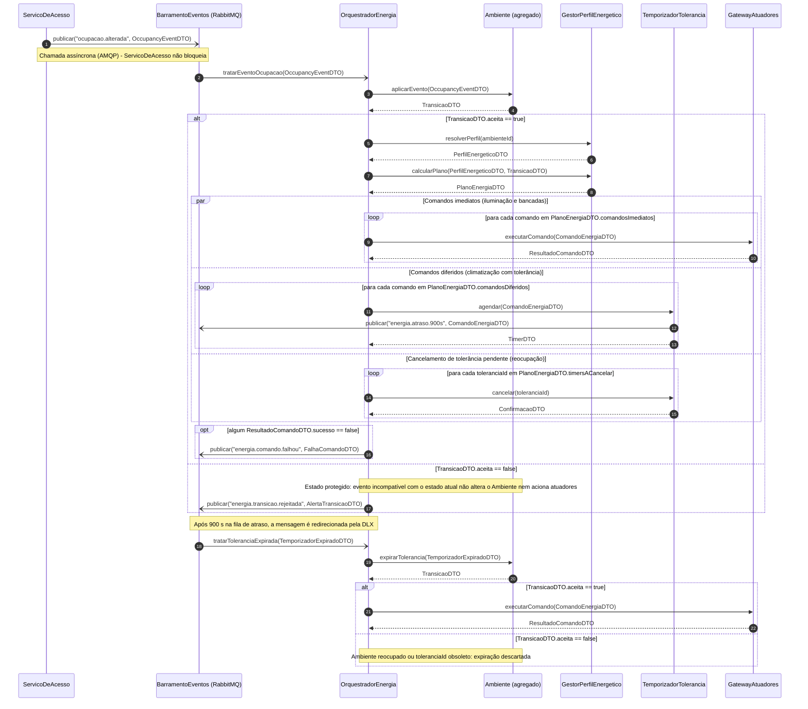
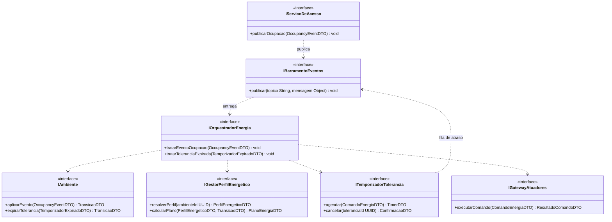
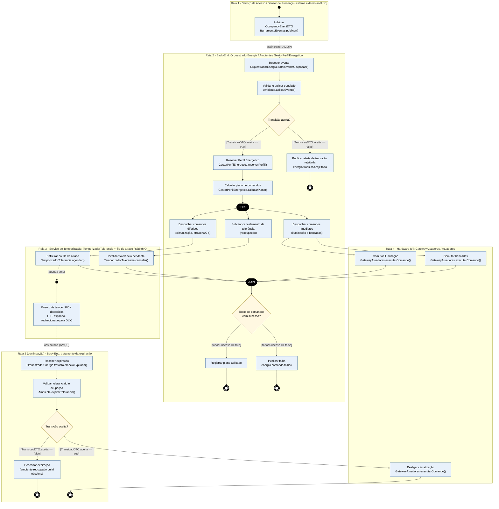
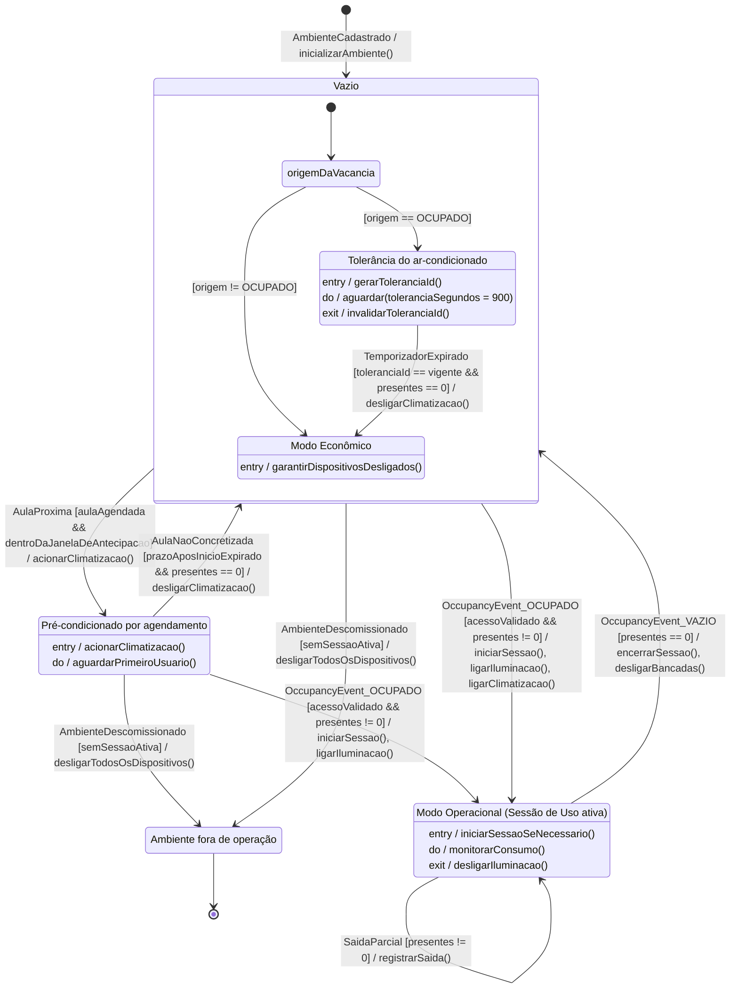

# APS 3 — Dossiê de Arquitetura Viva: Gestão de Perfis Energéticos

**Unidade Curricular:** Modelagem de Software · **Curso:** Engenharia de Software (4º Período — UniSenai)
**Projeto:** Smart Campus UniSenai · **Autor:** Henrique Chittolina · **Modalidade:** individual

## 1. Funcionalidade escolhida

**Gestão de Perfis Energéticos** — o mecanismo que traduz a mudança de ocupação de um Ambiente (laboratório/sala) em comandos de energia, conforme o Perfil Energético aplicado:

- **Iluminação:** reage de forma imediata (liga na entrada do primeiro usuário, desliga na saída do último).
- **Ar-condicionado:** permanece ligado por uma **janela de tolerância de 15 minutos (900 s)** após o Ambiente ficar vazio; se alguém entra e é autorizado na janela, o desligamento é cancelado.
- **Pré-condicionamento:** a Política de Agendamento antecipa a climatização quando há aula programada.

**Criticidade:** um erro aqui deixa energia ligada sem uso (desperdício) ou desliga equipamentos com o laboratório ocupado. O estado do Ambiente precisa ser protegido contra eventos fora de ordem, duplicados ou obsoletos.

### Regras de domínio utilizadas (Sprint 1)

| Regra | 
|---|
| Iluminação segue a ocupação sem tolerância |
| Ar-condicionado desliga somente após 15 min de ambiente vazio | 
| Sessão de Uso encerra apenas na saída do último usuário | 
| Atuadores só executam por decisão de ocupação/agendamento, nunca por conta própria |
| Ambiente só é "Ocupado" com Acesso validado (identidade + permissão) | 
| Estados do Ambiente: Vazio, Ocupado, Pré-condicionado | 

### Premissas adotadas nas lacunas do documento da Sprint 1

1. **Bancadas de computadores** não têm regra de tolerância definida (Seção 3.3): assumido desligamento imediato, configurável no `PerfilEnergeticoDTO`.
2. **Aula não concretizada** em Pré-condicionado tem comportamento indefinido (Seção 6.1): assumido retorno a Vazio com desligamento da climatização após prazo posterior ao início da aula.
3. **Contagem de presentes** (lacuna da Seção 2.3): assumido que o campo `presentes` vem no `OccupancyEventDTO`, calculado pelo Serviço de Acesso.
4. **Estado terminal `Desativado`** (descomissionamento do Ambiente) foi adicionado para atender ao requisito de estado terminal; não consta no documento da Sprint 1.
5. A validação de identidade e permissão ocorre **antes**, no Serviço de Acesso; este dossiê começa no `OccupancyEvent` já gerado.

## 2. Entidade principal e escopo dos diagramas

A entidade de domínio modelada na máquina de estados é o **Ambiente** (agregado). Os diagramas de sequência e atividades cobrem o fluxo de mudança de ocupação e a expiração da tolerância; o pré-condicionamento por agenda aparece na máquina de estados e no C4 (consulta ao Sistema de Grade Horária).

> Convenções Mermaid: `->>` = chamada síncrona bloqueante; `-)` = chamada assíncrona (mensageria); `-->>` = retorno com DTO. As raias do diagrama de atividades são `subgraph`; Fork/Join são barras pretas.

## 3. Artefato 1 — Diagrama de Sequência

**Operações públicas por linha de vida** (regra de consistência: toda mensagem recebida por uma linha de vida corresponde a uma operação abaixo):

**DTOs:**

| DTO | Campos principais |
|---|---|
| `OccupancyEventDTO` | `ambienteId`, `novoStatus` (OCUPADO/VAZIO), `presentes`, `origem` (ACESSO/SENSOR), `acessoValidado`, `timestamp` |
| `TransicaoDTO` | `aceita`, `estadoAnterior`, `estadoNovo`, `toleranciaId`, `toleranciaIdAnterior` |
| `PerfilEnergeticoDTO` | `perfilId`, `toleranciaClimatizacaoSegundos` (900), `toleranciaBancadasSegundos` (0), `janelaAntecipacaoMinutos` |
| `PlanoEnergiaDTO` | `comandosImediatos[]`, `comandosDiferidos[]`, `timersACancelar[]` |
| `ComandoEnergiaDTO` | `ambienteId`, `dispositivo` (ILUMINACAO/CLIMATIZACAO/BANCADAS), `acao` (LIGAR/DESLIGAR), `atrasoSegundos`, `toleranciaId` |
| `ResultadoComandoDTO` | `sucesso`, `dispositivo`, `erro` |
| `TimerDTO` / `ConfirmacaoDTO` | `timerId` (= `toleranciaId`) / `cancelado` |
| `TemporizadorExpiradoDTO` | `ambienteId`, `toleranciaId`, `comando` |
| `AlertaTransicaoDTO` / `FalhaComandoDTO` | `ambienteId`, `evento`, `motivo` / `comando`, `tentativas`, `erro` |

## 4. Artefato 2 — Diagrama de Atividades com Raias

## 5. Artefato 3 — Diagrama de Transição de Estados (Ambiente)

## 6. Artefato 4 — Visão de Contêineres C4 (Nível 2)

**C4-PlantUML** Imagem renderizada: [`c4-container.svg`](docs/architecture/c4-container.svg).

## 7. Artefato 5 — ADR 0001

[`docs/architecture/adr-0001.md`](docs/architecture/adr-0001.md) — *Temporização durável da janela de tolerância do ar-condicionado via RabbitMQ (TTL + Dead Letter Exchange)*. Status: Proposto.

## 8. Consistência entre os modelos

| Elemento | Sequência | Atividades | Estados | C4 |
|---|---|---|---|---|
| Recebe evento de ocupação | `tratarEventoOcupacao` | B1 | gatilho `OccupancyEvent_*` | Serviço de Energia ← Barramento (AMQP) |
| Valida transição no agregado | `Ambiente.aplicarEvento` | B2 / D1 | guardas `presentes`, `acessoValidado` | Serviço de Energia + PostgreSQL |
| Iluminação imediata / bancadas | `executarComando` (par/loop) | H1, H2 | `exit / desligarIluminacao()`, `desligarBancadas()` | gRPC → Gateway de Atuadores |
| Climatização com tolerância | `agendar` + `publicar(energia.atraso.900s)` | T1, B7 | `ToleranciaClimatizacao` (`do / aguardar(900)`) | fila de atraso no RabbitMQ |
| Cancelamento por reocupação | `cancelar(toleranciaId)` | T2, B8 | `exit / invalidarToleranciaId()` | Serviço de Energia |
| Expiração | `tratarToleranciaExpirada` / `expirarTolerancia` | C1, C2, D3 | `TemporizadorExpirado [...] / desligarClimatizacao()` | DLX → Serviço de Energia |
| Proteção contra estado inválido | `aceita == false` → `energia.transicao.rejeitada` | D1 → B3 | transições só nos pares de estado listados | — |
